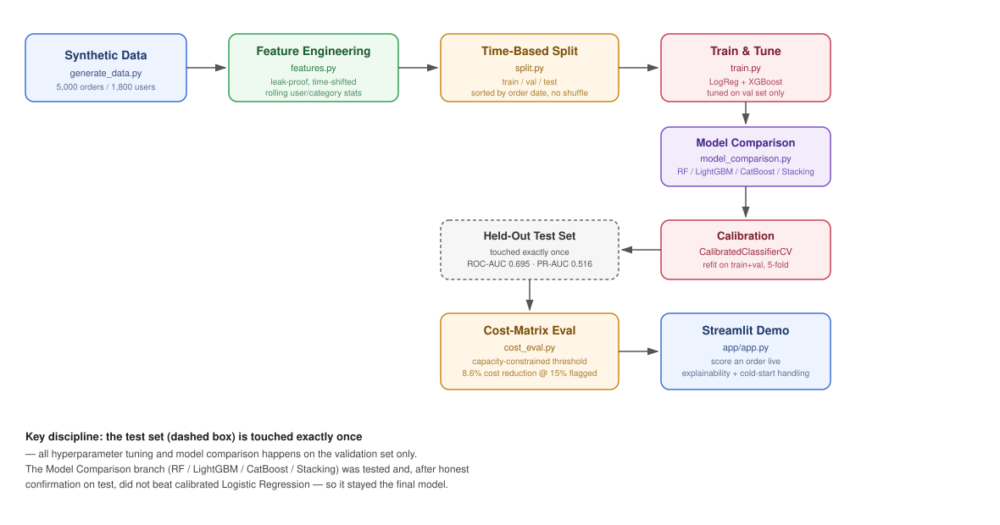
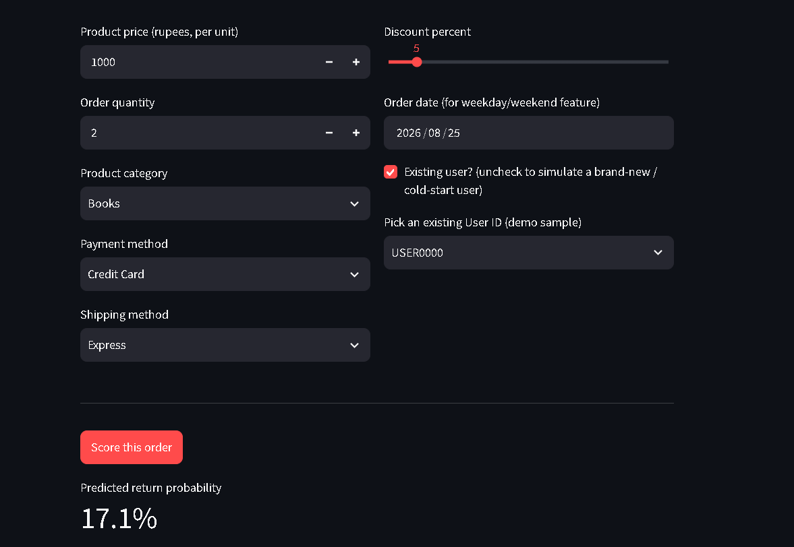
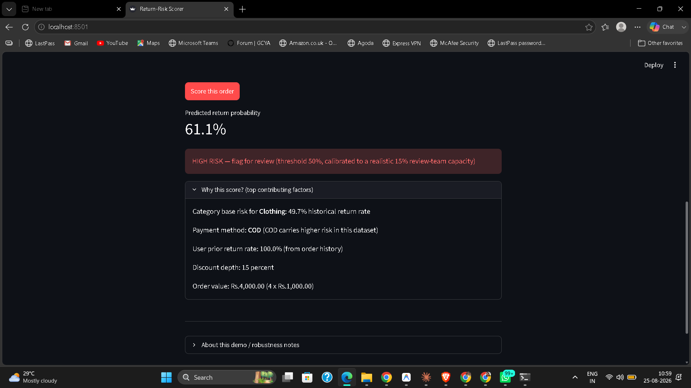

# Return-Risk Scorer

**Track 2: AI Risk Manager — Return-Risk Scorer**

Predicts the probability that an order will be returned, at checkout / return-request time, so a merchant's review team can proactively intervene on the highest-risk orders instead of reacting after the fact.

This system is **strictly defensive**: it only scores and flags orders for human review. It does not take any autonomous action against a customer (no auto-cancellation, no auto-blocking, no account penalties) — every flagged order goes to a human reviewer.

## Architecture



## Demo

| Low-risk order | High-risk order |
|---|---|
|  |  |

Both screenshots are from a genuine fresh `git clone` + `pip install -r requirements.txt` run — not the original dev environment — confirming the repo is self-contained and reproducible.

---

## Project Objectives

- Build a working return-risk detector for one merchant loss category (returns), using honest, leak-proof evaluation methodology.
- Report performance using metrics that reflect real business impact, including the cost of false positives — not just accuracy or AUC in isolation.
- Ship a working demo that a non-technical reviewer can interact with.

## What does it solve?

E-commerce returns are a major cost center for merchants: return shipping, restocking, and lost margin all add up. Most merchants only find out an order will be returned *after* it happens. This scorer estimates return risk **at order time**, so a merchant can:

- Flag a subset of high-risk orders for manual review (e.g. verify address, confirm order, apply stricter return terms) before shipping.
- Do this within a **realistic review-team capacity constraint**, rather than assuming unlimited manual review bandwidth.

### Why "capacity-constrained," not just "optimal"?

An unconstrained cost-minimizing threshold looks great on paper (an 18.8% reduction in return-related cost) but requires flagging **66% of all orders** for manual review — no real ops team can review two-thirds of order volume. We explicitly compute a second, **capacity-constrained** threshold that caps flagged orders at 15% of volume (a realistic review-team capacity assumption). At that constraint:

| Metric | Unconstrained (not deployable) | Capacity-constrained (deployable) |
|---|---|---|
| Orders flagged | 66% | 14.5% |
| Precision | 0.42 | 0.59 |
| Recall | 0.84 | 0.26 |
| Cost reduction vs. doing nothing | 18.8% | 8.6% |

**The 8.6% number, at 14.5% of orders flagged, is the one we lead with** — it's smaller, but it's the one an actual ops team could execute on day one.

## Model & Methodology

- **Data**: Synthetic dataset (5,000 orders, 1,800 users) generated with realistic, documented feature-target relationships (category risk, payment-method risk, discount effects, user return-history effects), because the originally provided dataset had almost no real predictive signal (ROC-AUC ~0.56–0.59). Full generation logic in `src/generate_data.py`.
- **Split**: Strict **time-based** 3-way split (train / validation / test, sorted by order date, no shuffling) — never a random split, since a random split would leak future information into training via time-aware rolling features.
- **Leak-proofing**: All user/category/product statistics are computed as *expanding, shifted* windows — only information available strictly *before* the order being scored is used. Return cost and profit-loss columns are excluded from model features entirely and reserved only for the cost-matrix evaluation step.
- **Hyperparameter tuning**: Done only on the validation set. Final models are refit on train+validation combined and evaluated exactly once on the untouched test set.
- **Calibration**: The final Logistic Regression model is wrapped in `CalibratedClassifierCV` (5-fold internal cross-fitting, sigmoid scaling). This does not change ranking ability (ROC-AUC is unchanged) but makes the raw probability values themselves trustworthy — which matters because the cost-matrix evaluation multiplies `predict_proba()` output directly against real cost figures. Calibration improved Brier score (a measure of probability accuracy) from 0.222 to 0.200.

### Final honest metrics (test set, n=1000, target rate 33%)

| Model | ROC-AUC | PR-AUC | Brier score |
|---|---|---|---|
| Logistic Regression (calibrated) | 0.695 | 0.516 | 0.200 |
| XGBoost (tuned) | 0.679 | 0.503 | — |

Logistic Regression modestly outperforms XGBoost here. On a dataset of this size (5,000 rows) with moderate signal, a simpler, better-regularized model generalizing slightly better than a more flexible one is a plausible and honestly-reported outcome, not a shortfall — we did not force a more complex model to "win."

## Model Selection: Why Logistic Regression, Not Something Fancier

Before finalizing the model, we tested four additional candidates — Random Forest, LightGBM, CatBoost, and a stacked ensemble (Logistic Regression + XGBoost combined via a meta-model) — to check whether a different framework could meaningfully beat our calibrated Logistic Regression. Full comparison code: `src/model_comparison.py`.

**Methodology**: since Logistic Regression and XGBoost had already been evaluated on the test set once, comparing new candidates against them on that same test set would itself be a form of data snooping — repeatedly consulting the test set until something looks best is not meaningfully different from tuning on it. So all four new candidates were compared on the **validation set only**. The single best-looking candidate was then confirmed on the test set exactly once, not searched over.

| Model | Validation PR-AUC |
|---|---|
| Logistic Regression (baseline) | 0.580 |
| LightGBM | 0.582 |
| Random Forest | 0.584 |
| CatBoost | 0.594 |
| **Stacked ensemble (LogReg + XGBoost)** | **0.602** |

The stacked ensemble looked like a real winner on validation — every candidate did, in fact, which is itself informative (see below). We refit it on train+val and confirmed it once on the untouched test set:

| Metric | Calibrated Logistic Regression (current) | Stacked Ensemble (candidate) |
|---|---|---|
| ROC-AUC | 0.695 | 0.693 |
| PR-AUC | 0.516 | 0.523 |
| Brier score (lower = better calibrated) | 0.200 | 0.224 |

**The validation-set gain did not hold up on test.** ROC-AUC was essentially flat (slightly worse), the PR-AUC gain shrank to something within noise on a 1,000-row test set, and — more importantly for this use case — the Brier score got meaningfully worse, meaning the stacked ensemble's probabilities are less trustworthy for the cost-matrix calculations that convert `predict_proba()` output directly into rupee figures.

**Decision: kept the calibrated Logistic Regression as the final model.** On a dataset of this size, differences that look real on ~600 validation rows can easily be sampling noise rather than genuine signal — and a model whose validation edge evaporates on test, while also degrading in calibration, is a worse choice than a simpler model with well-understood, stable behavior. We consider this a feature of the honest-evaluation methodology, not a wasted experiment: it's the same discipline (tune on validation, confirm on test exactly once, don't chase a bigger number that won't survive scrutiny) applied one level up, at the model-selection stage instead of just the hyperparameter stage.

## Issues Faced & Solutions

1. **Provided dataset had near-zero real signal.** ROC-AUC on the original dataset was ~0.56–0.59 regardless of feature engineering effort. *Solution*: generated a new synthetic dataset with documented, realistic feature-target relationships, so the exercise measures real modeling technique rather than fitting noise.
2. **Tuning-leakage risk.** An earlier version of the pipeline used a 2-way split and tuned hyperparameters using signal from the same data later used for final reporting. *Solution*: moved to a strict 3-way split — tune on validation only, refit on train+val, report on test exactly once.
3. **Unconstrained cost optimization was operationally meaningless.** The mathematically optimal threshold flagged 66–70% of orders — not deployable. *Solution*: added a capacity-constrained optimizer (`find_optimal_threshold_with_capacity`) that caps flagged-order percentage at a configurable review-team capacity, and report that number as the headline metric instead.
4. **Miscalibrated probabilities would have silently corrupted the cost-matrix math.** ROC-AUC/PR-AUC only measure ranking quality, not whether `predict_proba()` outputs are trustworthy as actual probabilities — which matters when those outputs are multiplied against real rupee costs. *Solution*: added `CalibratedClassifierCV`, verified Brier score improvement, and re-derived the capacity-constrained threshold against the calibrated model (the threshold shifted from 0.65 to 0.50 after calibration — thresholds must always be re-derived after any change to model calibration).
5. **Demo app had feature-name and unit mismatches against the trained model** (e.g. `discount_pct` is stored as a 0–1 fraction in training data, not 0–100; the cold-start sentinel for "days since last order" is `-1`, not a placeholder like 999). *Solution*: read the model's actual expected feature list directly from `src/features.py` rather than reconstructing it by hand, and verified sane, monotonically-ordered scores across known-user, cold-start, high-risk, and low-risk test cases before considering the demo done.
6. **Environment/version skew when moving from the dev machine to a fresh machine** (`AttributeError: 'LogisticRegression' object has no attribute 'multi_class'` after `pip install scikit-learn` grabbed a newer version than the one used for training). *Solution*: pinned exact package versions in `requirements.txt`.

## Project Structure

```
return-risk-scorer/
├── app/app.py                  # Streamlit demo
├── src/
│   ├── generate_data.py        # Synthetic dataset generator
│   ├── features.py             # Leak-proof feature engineering
│   ├── split.py                # Time-based train/val/test split
│   ├── train.py                # Model training, tuning, calibration
│   ├── model_comparison.py     # Alternative-model comparison (RF/LightGBM/CatBoost/stacking)
│   └── cost_eval.py            # Cost-matrix evaluation (incl. capacity constraint)
├── data/
│   ├── raw/                    # Raw synthetic dataset
│   └── processed/              # Engineered features, scored test set, cost sweep
├── models/                     # Saved model pipelines (.joblib)
├── docs/images/                # Architecture diagram, demo screenshots
├── requirements.txt
└── LICENSE
```

## Running the demo

```bash
pip install -r requirements.txt
python -m streamlit run app/app.py
```

## Disclaimer

This is a hackathon prototype using synthetic data. Business assumptions (review-team capacity, intervention recovery rate, friction cost per false positive) are documented in `src/cost_eval.py` and would need to be calibrated against a real merchant's actual data and operations before production use.
